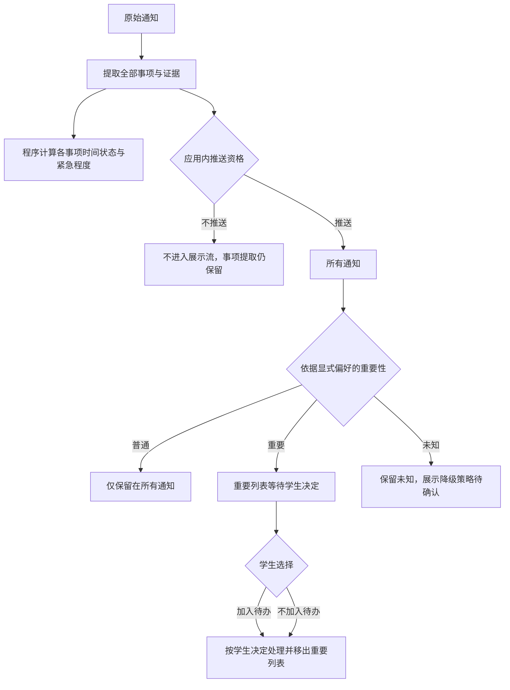

# 事项理解与分层判断数据结构建议

状态：**待用户确认的设计草稿，未冻结、未编码、未用于最终评分**。产品需求以 [require.md](../require.md#产品逻辑修正2026-11-02) 为准；15条参考和评估定义见 [审查稿](phase23-evaluation-review.md)。Notice v1与历史Analysis v1均保留，不能把旧结果直接转换成以下结构并称为新模型实测。

## 分层与权限

| 层 | 输出/责任 | 与后续交互的关系 |
| --- | --- | --- |
| 通知理解 | 通知类别、所有可区分事项及事实、证据、缺失、冲突 | 不按主体、历史性或是否需学生办理裁剪 |
| 展示资格 | Agent给出push/do_not_push及依据，表示是否进入应用内所有通知流 | 资格规则未定时值为null；不是系统消息 |
| 个性化重要性 | Agent结合显式偏好给出important/ordinary及依据 | 无偏好为null/不可评，不自动当普通 |
| 时间计算 | 程序产生生命周期、Deadline状态、剩余时间、紧急程度 | 不决定事项由谁执行、不创建待办 |
| 学生决策 | 后续交互中学生选择加入/不加入待办 | 两种决定前重要通知持续等待，决定后才移出重要列表；本轮不实现 |

建议输出不含action_required、should_act、create_todo、recommended_todo等全通知决定字段。具体要求作为原文事实提取，例如“学院在某日前审核”，不转述成“当前学生必须完成该审核”。重要通知是否进入待办不属于Agent输出。

下图仅说明概念分层，页面与学生交互均不在本轮实现：



不推送的通知不进入重要展示列表；不能由重要性或紧急程度暗中反转推送资格。未作学生决定时重要通知保持等待，不能因模型认为“不需行动”、已过期或未自动建待办就移出重要列表。

## 建议的对象关系

```text
NoticeUnderstandingDraft
  proposal_version: "matter-understanding.draft.1"
  notice_id, notice_content_hash, input_hash
  classification: Judgment<notice_category>
  matters: Matter[]
  missing_information: Gap[]
  conflicts: Conflict[]

NoticeJudgmentsDraft
  notice_id, understanding_hash, preferences_hash, display_policy_id
  display_eligibility: Judgment<"push" | "do_not_push">
  personalized_importance: Judgment<"important" | "ordinary">

TemporalAssessmentDraft       # 程序拥有，不接受LLM生成
  as_of, deadline_policy_version, urgency_policy_version
  matter_assessments: MatterTemporalAssessment[]
```

以上是分层关系建议，可在一个响应封装中并列，不要求新增多个Agent。无显式偏好仍可提取事项；推送资格不可用或不推送，也不能导致事项先被丢弃。日期、政策、输入版本分别留存，政策或偏好变化不改原始事实。

`Judgment<T>={value:T|null, status:known|unknown|not_evaluated, reason, evidence[], policy_ref?}`。理由不是证据替代品。个性化重要性的已知值需要通知和显式偏好两类依据，展示资格需要通知事实和明确展示政策；政策缺失不填猜测值。

## 事项和事实

```text
Matter
  matter_id                  # 程序分配，不能代表个人待办ID
  name: Fact<string>
  kind: activity | application | review | publication | objection |
        payment | scholarship_application | result_release | enrollment |
        procedure | assessment | funding_result | policy | historical_notice | other
  actors: Actor[]            # 分清执行者、审核者、参与对象、发布者
  purpose: Fact<string>
  audience: Fact<string>[]
  conditions: Fact<string>[]
  requirements: Fact<string>[]
  periods: TimeRange[]       # 可以多个时间段、各端点独立未知
  deadlines: Deadline[]      # 每个目的/主体的截止分别保留
  deadline_coverage: explicit | not_stated | unavailable | not_applicable
  locations: Location[]
  fees: Fee[]
  related_matters: {matter_id, relation, evidence[]}[]
  missing_information: Gap[]
  conflict_ids: string[]

Fact<T>
  value: T|null
  state: known | not_stated | unavailable | conflicting
  evidence: {field, quote, locator?}[]
  alternatives: {value, evidence[]}[]   # 冲突候选，非最终裁决
  explanation: string|null
```

- 空白/未提及/正文不可用/互相冲突不能全部折叠成“没有”；费用未提及不等于免费。确有“无费用”等否定陈述可用带证据的known值表达。
- 主体以组织/角色和职责为单位，`Actor={role, name:Fact<string>, responsibility, evidence[]}`；主体不明确就保留未知，不因通知发布在教务处自动认定教务处执行所有事项。共同审核者可在同一审核事项中列全，学生提交与学院审核必须是不同事项。
- 同一目的在不同段落重复出现可去重并保留全部依据；同日但不同目的不能合并。同一目标出现冲突日期时保留原文候选并关联冲突，不假装两个无关任务或任意选一个。
- `Fee={purpose, amount_raw, amount?, currency_raw, unit_raw, payer:Fact<string>, included[], excluded[], evidence[]}`。原文“约合人民币”标为原文估算，不用当前汇率重算；付款事项与费用金额资料分别关联。
- 地点、资格、费用、要求需按事项归属；共同条件可用明确引用关联，不能暗中复制给不适用事项。课程主题选项/住宿选项保持备选关系，不等于学生已选择。
- 名单或附件未读取时标明不可用，不编造名单成员、附件细节、资格或实际报名/办理完成情况。原文要求/历史计划并不证明事项实际完成。

## 时间、冲突与历史性

```text
TimePoint
  date: Fact<YYYY-MM-DD>
  time: Fact<HH:mm[:ss]>
  utc_offset: Fact<offset>
  raw_text, precision, evidence[]

TimeRange
  raw_text, start:TimePoint|null, end:TimePoint|null, evidence[]

Deadline
  deadline_id, purpose, responsible_actor_refs[]
  kind: submission | review | publication | objection | payment |
        scholarship_application | other
  at:TimePoint|null
  operator_raw                 # “前”“截至”等原文，不补00:00/23:59
  state: known | partial | unknown | conflicting
  alternatives: {raw_text, at?, evidence[]}[]
  raw_text, evidence[]
```

原文和每个端点各自保留依据。完整的开始日期不能因为结束年份缺失而一起置空；结束端不能仅靠开始端、标题年份、发布时间或URL补齐。`13.00`原样保留；本草稿沿用未确认新解析规则前不把它改成`13:00`的处理。英国时间只保存文字，UTC偏移未知；不凭校园或国家套时区。

```text
MatterTemporalAssessment
  matter_id
  scheduled_relation: past | future | ongoing | unknown
  historical: boolean|null
  completion_status: unknown   # 除非原文明确给出了实际完成事实
  basis: exact_instant | calendar_bound | source_period | insufficient
  basis_evidence[]
  deadline_assessments: DeadlineAssessment[]

DeadlineAssessment
  deadline_id
  deadline_state: expired | upcoming | due_now | unknown
  remaining_seconds: number|null
  remaining_bounds: {min?, max?}|null
  urgency: very_urgent | somewhat_urgent | not_urgent | null
  urgency_status: computed | inapplicable_expired | insufficient_time |
                  pending_policy | conflicting_time
  reason, calculation_basis, as_of
```

没有截止的事项通过`deadline_coverage`表达，不虚造Deadline；“源文未给截止”“正文不可用”“明确无截止”分别处理。不要用不紧急代替截止未知或无截止。每个事项、每个不同目的Deadline单独计算，不擅自把最紧急的学院任务当成学生个人任务，也不在本轮制定通知整体聚合规则。

### 时间判定建议（仍待确认）

| 已知资料 | 过期/剩余时间 | 紧急程度 |
| --- | --- | --- |
| 精确可靠截止已早于as_of | expired，精确剩余秒数可为负数 | null，inapplicable_expired |
| 精确截止恰为as_of | 建议due_now；是否此刻即过期待确认 | 建议very_urgent，尚未冻结边界 |
| 0 < 剩余时间 <= 24小时 | upcoming，按实际瞬间计算 | very_urgent，24小时端点包含 |
| 剩余时间 > 24小时 | upcoming | null/pending_policy：较紧急边界未定，不能全部归为不紧急 |
| 日期/时刻/时区不足，无法定位截止 | unknown，remaining_seconds=null | null/insufficient_time |
| 有日期冲突 | 保留候选；精确剩余秒数未知 | 通常null/conflicting_time；不能择一计算 |

“是否明显已过去”可以比“精确还有几秒”更早确定。建议保守使用日期/年度边界：只有在所有合法偏移、源文候选和日内时刻都落在as_of之前时，标记expired并说明calendar_bound；不据此补写来源时区或23:59。若尚未确定日期边界算法则保留该理由为待实现建议，不宣称已有程序支持。

第13条的2025年两个校内日期候选、4月15日审核、4月18日公示、5月5日外方网申，在2026-11-01T00:00:00Z均已过去；即使两个校内日期冲突，两者都过期。2025年秋季项目整体是历史计划；不能因此补出结束端完整日期，也不能说学生已经参加/取得证书。未标具体时刻的学分/出国手续保留“历史项目关联、截止未给”。这种年度/候选一致的历史判定与精确倒计时分开。

本轮参考的固定as_of继续为2026-11-01T00:00:00Z，不随当前会话日期改变，也不改旧评估文件。日期明确且远离边界的事项可标日历意义的过去/未来；年份不明确的第3/4/5/10条，不从标题、落款或URL擅补日期来计算过期。

## 兼容与未定策略

建议未来以独立理解版本保存matters，不原地改写Analysis v1的events/registration_deadlines/action_required。旧重要性high/medium/low不能映射成新的个性化important/ordinary，旧urgency.v1的72小时阈值也不能迁移成新政策。旧15条只能作历史实现的模型与工具证据，新字段当时未产出应标unavailable，不能填反推值或直接宣判新能力正确。

待用户决定的策略：

1. 推送资格具体依据哪些来源、质量、范围或用户条件；现有15条均暂留推送参考null，不能因历史性或无正文自动不推送。
2. 较紧急上界，以及超过24小时但政策未定时继续保留pending_policy；本轮不提议数字阈值。
3. 精确截止等于as_of采用due_now还是expired；上表给出了建议但未冻结。

个人重要列表、学生处理决定和未来消息接口仅作为产品边界说明，本轮不设计页面、交互实现、待办写入、消息发送或日历接口。
